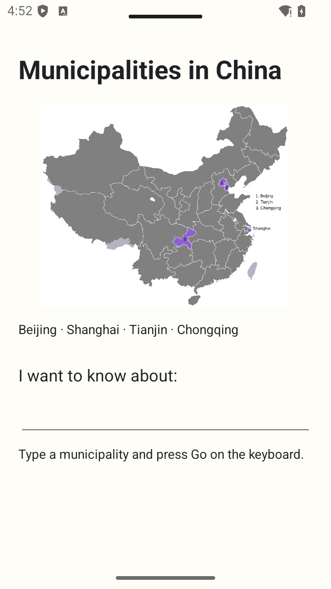
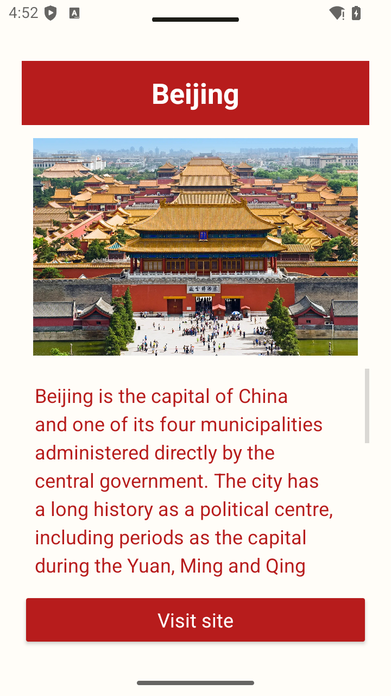
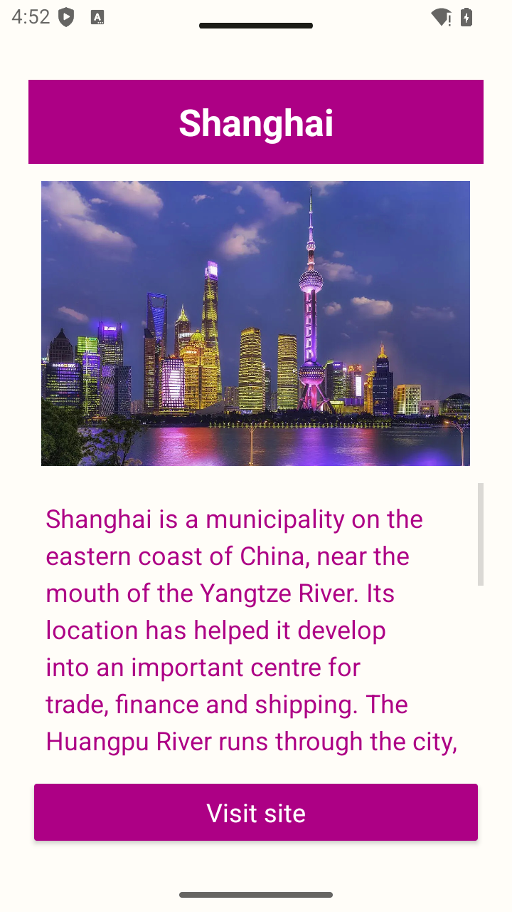
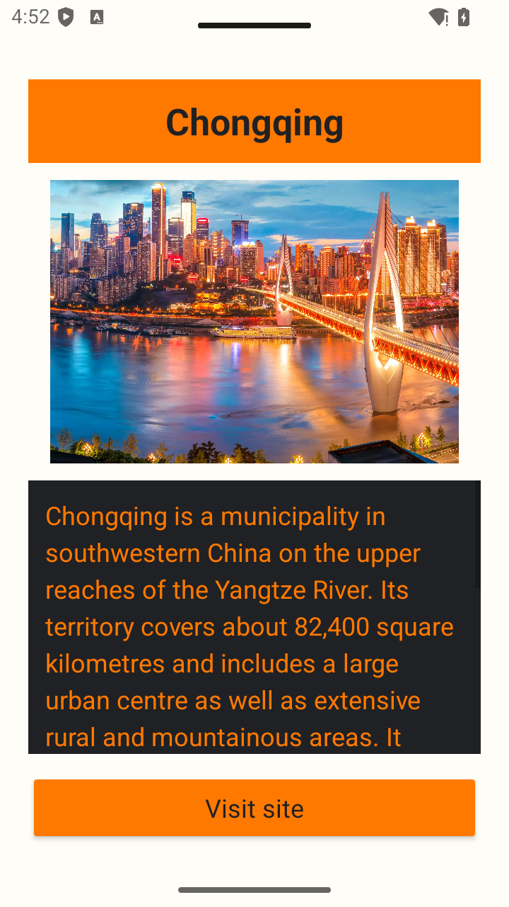
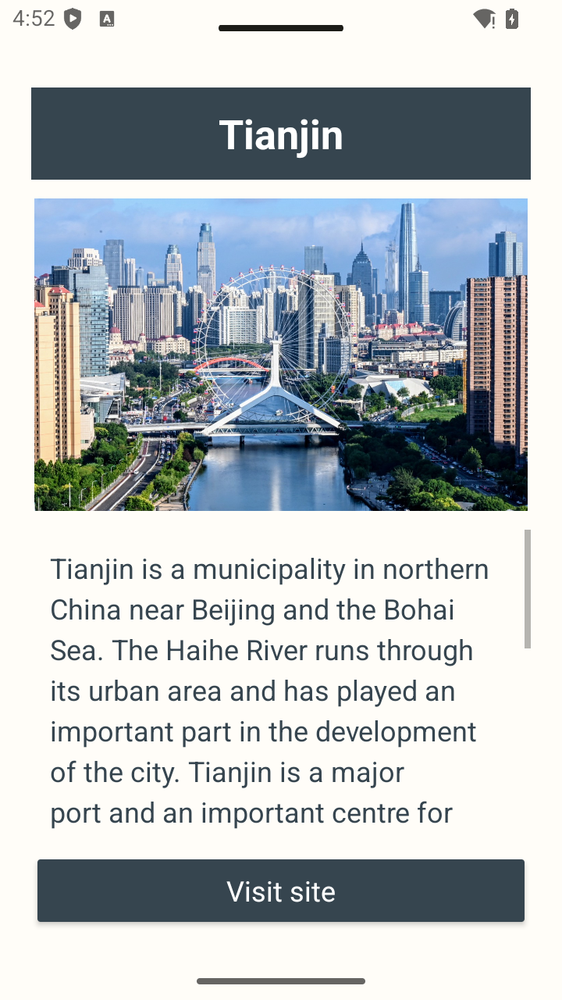

# PracticalFive

Student ID: **20243006963**

A Java and XML Android application for looking up China's four municipalities.

## Run the app

Open this folder in Android Studio, allow Gradle to sync, and run the `app` configuration on a device or emulator with Android 7.0 (API 24) or later. This project uses Android Gradle Plugin 9.4.1, Gradle 9.8.0 and compile SDK 37. Use JDK 21 or the compatible JDK bundled with Android Studio.

Enter Beijing, Shanghai, Tianjin or Chongqing and press **Go** on the keyboard. Input is case-insensitive, and surrounding spaces are ignored. An empty or unsupported name shows an error without leaving the first screen.

The second screen shows the selected municipality's picture and summary. **Visit site** opens its official website in a browser. The information section scrolls independently, keeping the button accessible.

## Main files

- `MainActivity.java`: keyboard input, validation errors and the explicit intent.
- `TextProcessor.java`: validation and normalisation shared by both activities.
- `Municipality.java`: receives the name, chooses resources and opens the official website using an implicit intent.
- `ScreenInsets.java`: keeps content clear of system bars and the keyboard on recent Android versions.
- `res/layout/`: the two XML screen layouts.
- `res/values/`: strings, colours and the municipality information array.

The array order is **Beijing, Shanghai, Chongqing, Tianjin**, following the written requirement. The example array in the practical lists the last two cities differently.

## Checks

```sh
./gradlew assembleDebug testDebugUnitTest lintDebug
./gradlew connectedDebugAndroidTest
```

On Windows, use `gradlew.bat`. The connected tests require a running emulator or connected device. See [TESTING.md](TESTING.md) for the checks performed and their limits.

Information sources and image attribution are listed in [SOURCES.md](SOURCES.md).

## Screenshots

| Main screen | Beijing | Shanghai |
| --- | --- | --- |
|  |  |  |

| Chongqing | Tianjin |
| --- | --- |
|  |  |
